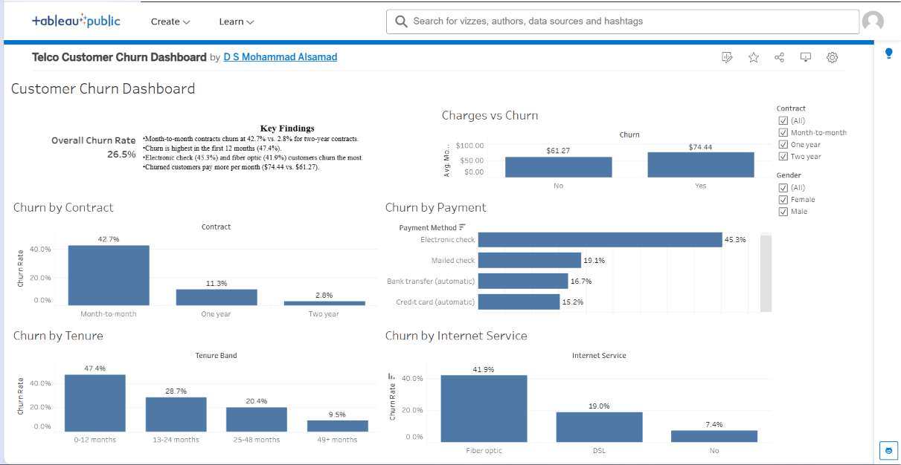

# Telco Customer Churn Dashboard (Tableau)

**Live dashboard:** [View on Tableau Public](https://public.tableau.com/views/TelcoCustomerChurnDashboard_17936862915590/CustomerChurnDashboard)

## Business question
Which customer segments churn the most, and where should the company focus its retention efforts?

## Dataset
Telco Customer Churn (Kaggle): 7,043 customers, 21 attributes covering contract type, tenure, services, billing and churn status.

## What I did
- Cleaned the data in Tableau (converted TotalCharges to numeric, handled 11 null values from new customers with zero tenure)
- Created calculated fields: Churn Flag, Churn Rate, Tenure Band
- Built 6 worksheets and combined them into one interactive dashboard with Contract and Gender filters

## Key findings
- Overall churn rate is 26.5%
- Month-to-month customers churn at 42.7% vs. 2.8% for two-year contracts
- Churn is highest in the first 12 months (47.4%)
- Electronic check users (45.3%) and fiber optic customers (41.9%) churn the most
- Churned customers pay more per month on average ($74.44 vs. $61.27)

## Recommendations
- Offer discounts or incentives to move month-to-month customers onto longer contracts
- Run onboarding and retention campaigns in the first 12 months
- Promote auto-pay options to electronic check users
- Review pricing and service quality for fiber optic plans

## Tools
Tableau Public, calculated fields, interactive filters and dashboard design

## Files
- `Telco Customer Churn Dashboard.twbx`: Tableau workbook
- `telco_churn.csv`: dataset
- `dashboard.png`: dashboard screenshot
